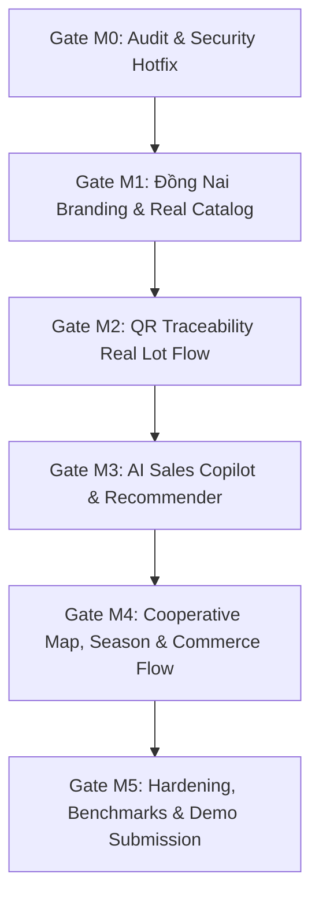

# KẾ HOẠCH NÂNG CẤP VÀ MIGRATION AN TOÀN (GATE M0)

**Dự án:** CropNet Đồng Nai AI  
**Mục tiêu:** Nâng cấp hệ thống từ codebase CropNet ban đầu lên nền tảng thương mại nông sản thông minh Thành phố Đồng Nai tích hợp AI, bảo đảm tính liên tục của hệ thống, không phá vỡ các chức năng đã hoạt động.

---

## 1. Nguyên tắc cốt lõi
1. **Bảo toàn chức năng gốc:** Giữ nguyên các module đang hoạt động tốt (Order checkout transaction, Role authentication, Product listing, Forum, Static deploy workflow).
2. **Không thay thế tùy tiện:** Giữ Express.js + Next.js App Router + Prisma ORM. Không thay bằng Next-only hay Supabase/Medusa để tránh rủi ro phá vỡ toàn bộ kiến trúc đang có.
3. **Fail-Closed & Chống dữ liệu giả:** Trong môi trường production, mọi kết nối DB/Auth/QR phải minh bạch, không tự sinh báo cáo kiểm nghiệm giả hoặc số liệu bán hàng bịa đặt.
4. **Minh bạch nhãn dữ liệu:** Dữ liệu mô phỏng trong giai đoạn demo trước đối tác phải được gắn nhãn rõ ràng: `DỮ LIỆU MÔ PHỎNG HỢP TÁC XÃ TP ĐỒNG NAI`.

---

## 2. Lộ trình Migration theo từng Gate

### Gate M0 — Audit & Security Hotfix (Hoàn thành)
- Loại bỏ fallback gán lô giả `MOCK_BATCHES[0]`.
- Loại bỏ tự động tạo báo cáo kiểm định `PASSED` và chuyến xe vận chuyển giả.
- Bảo mật JWT, upload endpoint và chống race condition đơn hàng.

### Gate M1 — Đồng Nai Branding, 2026 Admin Units & Partner Profile
- Đơn vị hành chính: Cập nhật Thành phố Đồng Nai (Nghị quyết 30/2026/QH16, mã tỉnh 75, 95 xã/phường).
- Chủ thể đại diện: **Hợp Tác Xã Nông Nghiệp Dịch Vụ Thương Mại Nông Sản Tân Triều** và **Hợp Tác Xã Nông Nghiệp Sinh Thái Long Khánh**.
- Cập nhật danh mục sản phẩm đặc sản Đồng Nai (Bưởi Tân Triều, Sầu riêng Long Khánh, Chôm chôm nhãn, Hạt điều).
- Cập nhật UI Header, Footer, Hero, ProductCard, Meta SEO.

### Gate M2 — QR Traceability Real Lot Flow
- Nhật ký canh tác theo thời gian thực (tưới tiêu, bón phân hữu cơ, tỉa cành, thu hoạch, đóng gói).
- Trình tạo và quét mã QR trên trình duyệt (hỗ trợ camera di động qua HTTPS và upload ảnh QR).
- Hỗ trợ routing động `/traceability/[batchCode]` và query route `/traceability?batch=...` tương thích GitHub Pages.

### Gate M3 — AI Sales Copilot & Recommender
- Xây dựng module `apps/server/src/modules/ai/`.
- Chatbot 24/7 gọi công cụ (tool calling) truy xuất dữ liệu sản phẩm, lô hàng, mùa vụ, chính sách từ cơ sở dữ liệu thật.
- Gợi ý sản phẩm thông minh theo ngân sách (tính toán giá và tồn kho server-side, không để LLM tự quyết giá).
- Chuyển giao hỗ trợ khách hàng sang nhân viên khi thiếu căn cứ.
- Bộ đo lường AI vs Baseline (30 tình huống thực tế).

### Gate M4 — Cooperative Map, Season & Commerce Flow
- Bản đồ nhà vườn tương tác với OpenStreetMap tile policy & geocoding hợp lệ.
- Lịch mùa vụ thu hoạch nông sản Đồng Nai.
- Giỏ hàng & yêu cầu báo giá sỉ (B2B Quote Draft).
- Dashboard thống kê cho Hợp tác xã và Quản trị viên.

### Gate M5 — Hardening, Benchmarks & Demo Submission
- Kiểm tra toàn diện typecheck, linting, build server và build web.
- Bộ tài liệu hồ sơ dự thi hoàn chỉnh phục vụ nộp Ban Tổ chức DIGIFEST Đồng Nai 2026.
