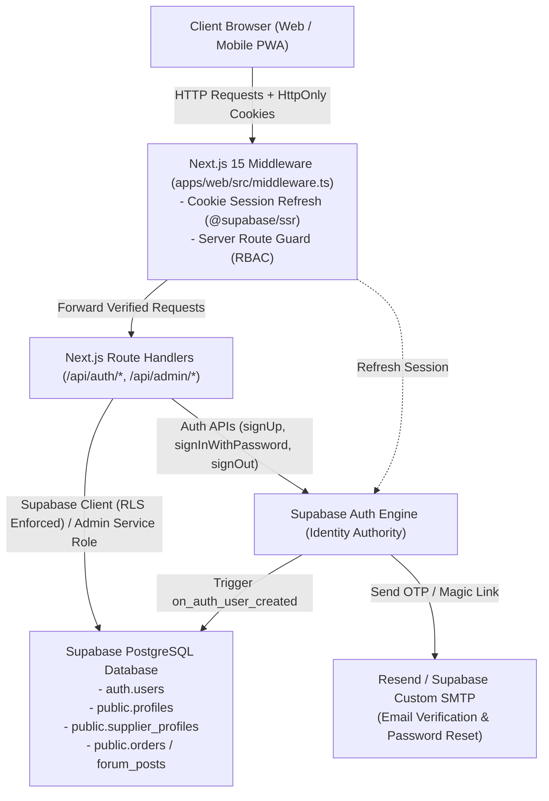
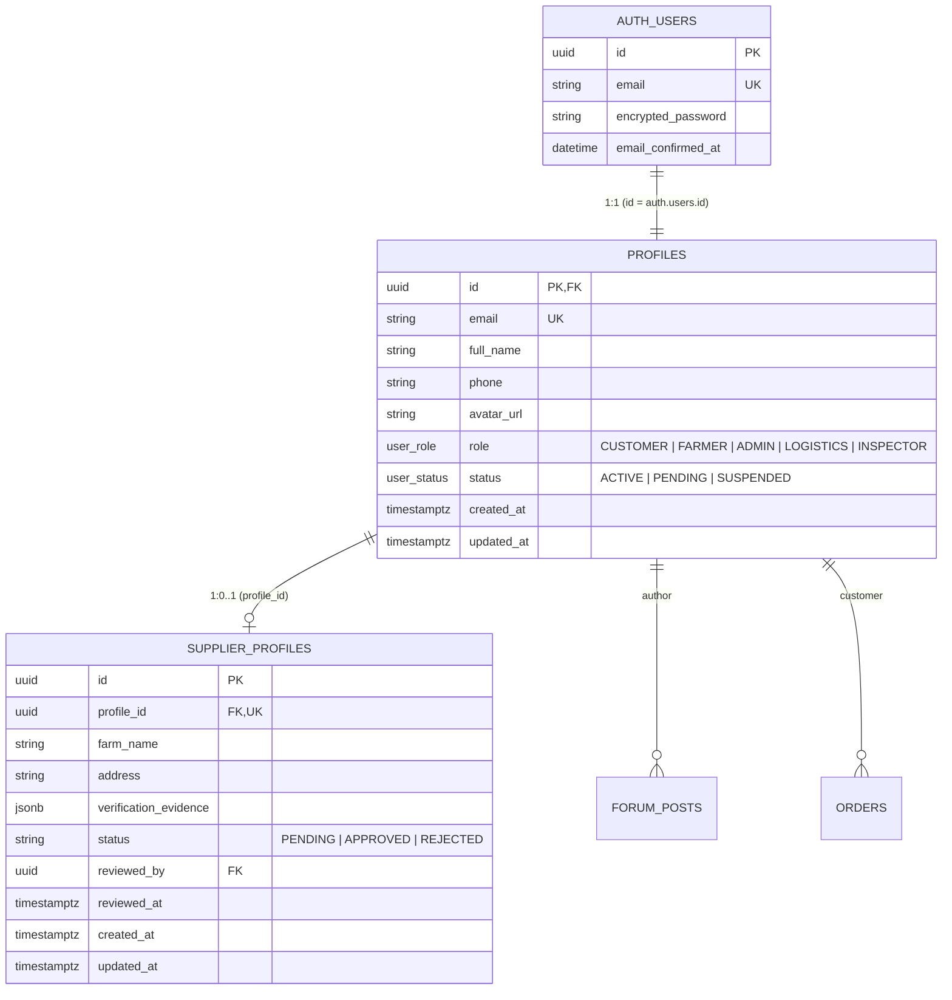

# KIẾN TRÚC XÁC THỰC BẢO MẬT & BỀN VỮNG (AUTH ARCHITECTURE)
## Dự án: CropNet Đồng Nai AI (DiGiFest 2026)
**Phiên bản:** 2.0 (Supabase Auth + PostgreSQL + Next.js 15 App Router SSR)  
**Ngày phát hành:** 15/10/2026  

---

### 1. SƠ ĐỒ KIẾN TRÚC TỔNG THỂ (SYSTEM ARCHITECTURE)

---

### 2. NGUYÊN TẮC CỐT LÕI (CORE PRINCIPLES)

1. **Một nguồn sự thật duy nhất (Single Source of Truth):**
   - Định danh người dùng do `auth.users` của Supabase Auth quản lý.
   - Hồ sơ người dùng và vai trò phân quyền do bảng `public.profiles` và `public.supplier_profiles` trong Supabase PostgreSQL quản lý.
   - Chấm dứt hoàn toàn việc lưu trữ tài khoản trong RAM state và tệp tạm `/tmp/cropnet_store.json`.
2. **Không phân quyền dựa trên dữ liệu Client (Server-Enforced RBAC):**
   - Vai trò (`role`) không bao giờ được tin cậy từ `user_metadata` hoặc `localStorage` do client gửi lên.
   - Khi đăng ký, Database Trigger `handle_new_user()` tự động gán role `CUSTOMER` (hoặc `FARMER` ở trạng thái `PENDING`). Mọi nỗ lực gửi role `ADMIN`, `INSPECTOR`, `LOGISTICS` đều bị chặn đứng ở mức database trigger.
3. **Quản lý phiên bằng HttpOnly Cookie qua `@supabase/ssr`:**
   - Phiên làm việc (Session) được lưu trong cookie an toàn (HttpOnly, Secure, SameSite=Lax).
   - Loại bỏ hoàn toàn việc lưu Access Token nhạy cảm trong `localStorage`.
   - `apps/web/src/middleware.ts` tự động gia hạn token (Refresh Token Rotation) cho mỗi request.
4. **Không trả Token nhạy cảm ra API Response (Zero Token Leakage):**
   - Các API `register`, `send-verification`, `forgot-password` tuyệt đối không chứa token trong JSON trả về.
   - Thông báo gửi email chỉ xuất hiện khi email thực sự được dispatch thành công qua SMTP; nếu chưa cấu hình SMTP, trả về mã trạng thái trung thực `BLOCKED_EMAIL_PROVIDER`.

---

### 3. MÔ HÌNH DỮ LIỆU & QUAN HỆ BẢNG (DATA MODEL)

---

### 4. ROW LEVEL SECURITY (RLS) POLICIES

| Bảng | Thao tác | Quyền hạn (Policy Rule) |
|---|---|---|
| `public.profiles` | `SELECT` | Cho phép người dùng đọc thông tin chính mình (`auth.uid() = id`) HOẶC người dùng có role `ADMIN`. |
| `public.profiles` | `UPDATE` | Cho phép người dùng sửa `full_name`, `phone`, `avatar_url` của mình. Không thể tự sửa `role` hoặc `status` (cần `ADMIN` hoặc service role). |
| `public.supplier_profiles` | `SELECT` | Chủ nhà vườn (`profile_id = auth.uid()`) xem được hồ sơ của mình; `ADMIN` xem được tất cả đơn đăng ký. |
| `public.supplier_profiles` | `UPDATE` | Chỉ tài khoản có role `ADMIN` mới có quyền thay đổi `status` thành `APPROVED` / `REJECTED` và cập nhật `reviewed_by`, `reviewed_at`. |

---

### 5. MA TRẬN PHÂN QUYỀN (RBAC MATRIX)

| Route / Hành động | CUSTOMER | FARMER (Pending) | FARMER (Approved) | ADMIN | Khách vãng lai |
|---|---|---|---|---|---|
| Trang chủ, Nông sản, Bản đồ, QR, AI Chat | Cho phép | Cho phép | Cho phép | Cho phép | Cho phép |
| Đặt hàng nông sản | Cho phép | Cho phép | Cho phép | Cho phép | Cho phép |
| Diễn đàn: Xem bài viết | Cho phép | Cho phép | Cho phép | Cho phép | Cho phép |
| Diễn đàn: Đăng bài / Bình luận / Thích | Cho phép | Cho phép | Cho phép | Cho phép | Yêu cầu đăng nhập |
| Dashboard Cá nhân (`/dashboard/customer`) | Cho phép | Chuyển hướng | Chuyển hướng | Cho phép | Yêu cầu đăng nhập |
| Dashboard Nhà vườn (`/dashboard/supplier`) | Bị từ chối (403) | Chuyển hướng `/pending` | Cho phép | Cho phép | Yêu cầu đăng nhập |
| Dashboard Quản trị (`/admin`) | Bị từ chối (403) | Bị từ chối (403) | Bị từ chối (403) | Cho phép | Yêu cầu đăng nhập |
| Duyệt hồ sơ HTX / Khóa tài khoản | Bị từ chối (403) | Bị từ chối (403) | Bị từ chối (403) | Cho phép | Bị từ chối (403) |

---

### 6. QUY TRÌNH XÁC MINH EMAIL & QUÊN MẬT KHẨU (EMAIL WORKFLOW)

1. **Đăng ký tài khoản mới:**
   - Client gửi thông tin tới `/api/auth/register`.
   - Backend gọi `supabase.auth.signUp()`.
   - Supabase tự động gửi email kích hoạt chứa link OTP hoặc confirmation link trỏ về:
     `https://cropnetkhoaduc.vercel.app/api/auth/callback?next=/`
   - Response trả về `{ success: true, message: "Vui lòng kiểm tra hộp thư email..." }` mà không chứa bất kỳ token nào.
2. **Khôi phục mật khẩu (Forgot Password):**
   - Client gửi email tới `/api/auth/forgot-password`.
   - Backend gọi `supabase.auth.resetPasswordForEmail()` với redirect URL:
     `https://cropnetkhoaduc.vercel.app/reset-password`
   - Bảo vệ Anti-Enumeration: Bất kể email có tồn tại hay không, luôn phản hồi cùng một thông điệp an toàn.
3. **Cập nhật mật khẩu mới (Reset Password):**
   - Người dùng click link trong email, được xác thực phiên recovery tự động.
   - Nhập mật khẩu mới tại `/reset-password`.
   - Backend gọi `supabase.auth.updateUser({ password })`.
