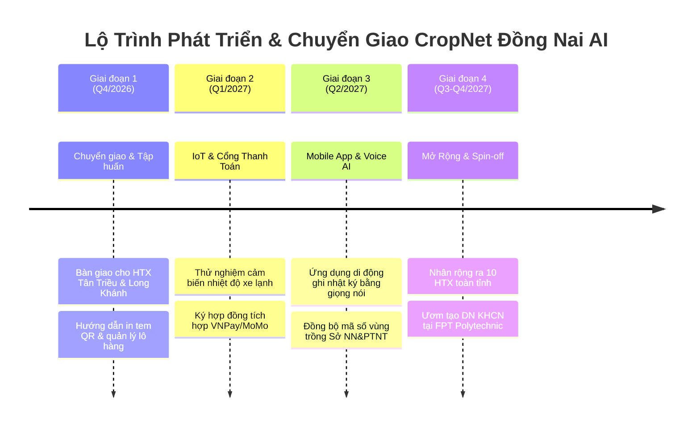

# LỘ TRÌNH PHÁT TRIỂN & CHUYỂN GIAO SAU CUỘC THI (POST-CONTEST ROADMAP)
## Dự Án: CropNet Đồng Nai AI
### Cuộc thi AI Digital Business Challenge 2026 — DiGiFest Đồng Nai 2026

---

## 1. TỔNG QUAN CAM KẾT CHUYỂN GIAO

Căn cứ theo định hướng tại **Kế hoạch số 141-KH/TĐTN-CTĐTTN (Mục I.1 & Mục III.1)** của Thành đoàn Đồng Nai và Trường CĐ FPT Polytechnic Đồng Nai:
> *"Lựa chọn những sản phẩm có tiềm năng để tiếp tục hoàn thiện, kết nối, chuyển giao và ứng dụng cho doanh nghiệp, hộ kinh doanh, hợp tác xã hoặc dự án khởi nghiệp."*

Nhóm phát triển CropNet Đồng Nai AI xây dựng lộ trình 4 giai đoạn cụ thể nhằm đưa nền tảng vào phục vụ đời sống nông nghiệp và kinh tế số thực tế của tỉnh Đồng Nai sau khi kết thúc DiGiFest 2026.

---

## 2. CHI TIẾT CÁC GIAI ĐOẠN TRIỂN KHAI (2026 - 2027)

---

### GIAI ĐOẠN 1: BÀN GIAO, TẬP HUẤN & VẬN HÀNH THÍ ĐIỂM (Tháng 11/2026 – Tháng 12/2026)
* **Đối tác phối hợp:** 
  - Hợp Tác Xã Nông Nghiệp Dịch Vụ Tân Triều (Huyện Vĩnh Cửu).
  - Hợp Tác Xã Nông Nghiệp Sinh Thái Long Khánh (TP. Long Khánh).
  - Đoàn Khối Cơ quan & Doanh nghiệp Tỉnh Đồng Nai.
* **Mục tiêu then chốt:**
  1. **Bàn giao tài khoản & Thiết bị:** Cấp tài khoản quản trị cho Ban Giám đốc 2 HTX; hướng dẫn nhân viên kỹ thuật sử dụng máy in nhiệt cầm tay kết nối Bluetooth để in mã QR dán trực tiếp lên từng quả bưởi và thùng trái cây.
  2. **Tập huấn thực địa "Cầm tay chỉ việc":** Tổ chức 02 buổi tập huấn tại nhà văn hóa ấp Tân Bình (Vĩnh Cửu) và phường Xuân Lập (Long Khánh), hướng dẫn nông dân chụp ảnh nhật ký chăm sóc cây và cập nhật đợt bón phân sinh học lên nền tảng.
  3. **Vận hành đợt Tết Nguyên Đán 2027:** Triển khai tem QR truy xuất thật cho 5.000 trái Bưởi Đường Lá Cam và Bưởi Da Xanh phục vụ giỏ quà Tết Đồng Nai.

---

### GIAI ĐOẠN 2: TÍCH HỢP IoT CHUỖI LẠNH & CỔNG THANH TOÁN QUỐC GIA (Quý 1/2027)
* **Mục tiêu kỹ thuật & thương mại:**
  1. **Tích hợp cảm biến IoT giám sát chuỗi lạnh (Cold-Chain IoT):**
     - Thử nghiệm lắp đặt thiết bị cảm biến nhiệt độ & độ ẩm không dây (ESP32 + cảm biến SHT30) trên các thùng xe tải đông lạnh vận chuyển nông sản từ Đồng Nai đi TP.HCM.
     - Dữ liệu cảm biến tự động bắn về API `/api/batches/:code/temperature` mỗi 15 phút, hiển thị trực quan biểu đồ nhiệt độ bảo quản trên trang QR truy xuất, cam kết nông sản không bị đứt gãy chuỗi lạnh.
  2. **Ký kết tích hợp Cổng thanh toán chính thức:**
     - Ký kết hợp đồng đơn vị chấp nhận thanh toán với VNPay QR và MoMo Doanh Nghiệp, thay thế cơ chế quét mã QR tĩnh chuyển khoản ngân hàng hiện tại.
     - Tự động đối soát hoa hồng và phân bổ dòng tiền trực tiếp về tài khoản ngân hàng của từng hộ nông dân thành viên.

---

### GIAI ĐOẠN 3: ỨNG DỤNG DI ĐỘNG & GHI NHẬT KÝ BẰNG GIỌNG NÓI (Quý 2/2027)
* **Nâng cấp trải nghiệm người nông dân (Farmer-centric AI):**
  1. **CropNet Mobile App (React Native):**
     - Phát triển ứng dụng gọn nhẹ hoạt động được trên cả smartphone cấu hình thấp của bà con nông dân.
     - Hỗ trợ chế độ ngoại tuyến (Offline Mode): Nông dân vẫn ghi được nhật ký bón phân, tưới nước khi đang ở trong vườn không có sóng 4G/Wifi; dữ liệu tự động đồng bộ khi có kết nối trở lại.
  2. **Trợ lý Voice-to-Text AI tiếng Việt giọng Nam Bộ:**
     - Ứng dụng mô hình Whisper AI xử lý giọng nói thành văn bản, nhận diện tốt thuật ngữ nông nghiệp địa phương (ví dụ: *"xịt chế phẩm vi sinh"*, *"bao trái sầu riêng"*, *"tỉa cành vượt"*).
     - Giúp các cô chú nông dân lớn tuổi không cần bấm phím gõ chữ mà chỉ cần bấm nút micro nói 10 giây là hoàn tất nhật ký canh tác.
  3. **Kết nối Cơ sở dữ liệu Mã số vùng trồng (MSVT):**
     - Đăng ký kết nối dữ liệu chuyên ngành với Chi cục Trồng trọt và Bảo vệ thực vật Đồng Nai để tra cứu tình trạng cấp mã số vùng trồng xuất khẩu chính ngạch sang Trung Quốc, EU.

---

### GIAI ĐOẠN 4: NHÂN RỘNG TOÀN TỈNH & ƯƠM TẠO DOANH NGHIỆP SPIN-OFF (Quý 3 – Quý 4/2027)
* **Mở rộng quy mô & Phát triển bền vững:**
  1. **Mở rộng danh mục 10+ Hợp tác xã OCOP Đồng Nai:**
     - Đưa thêm các nông sản tiêu biểu vào nền tảng: Chuối già Nam Mỹ (Trảng Bom), Tiêu Chợ Chôm (Xuân Lộc), Hạt Sen Vĩnh An (Vĩnh Cửu), Mãng cầu Thạnh Phú, Nấm mối đen Long Thành.
  2. **Thành lập Doanh nghiệp Khởi nghiệp Đổi mới Sáng tạo (Spin-off Startup):**
     - Đăng ký ươm tạo tại Trung tâm Khởi nghiệp & Đổi mới sáng tạo Trường CĐ FPT Polytechnic cơ sở Đồng Nai và Tỉnh đoàn Đồng Nai.
     - Tìm kiếm nguồn vốn đầu tư hạt giống (Seed Funding) từ các quỹ phát triển kinh tế tập thể và vườn ươm khởi nghiệp nông nghiệp số.
  3. **Đóng góp chỉ số Chuyển đổi số tỉnh Đồng Nai (DTI):**
     - Cung cấp Dashboard phân tích số liệu tổng hợp về sản lượng OCOP và dòng luân chuyển hàng hóa nông sản số cho Sở Nông nghiệp & PTNT và Sở Thông tin & Truyền thông tỉnh Đồng Nai tham khảo điều hành.

---

## 3. NGUỒN LỰC VÀ ĐIỀU KIỆN ĐẢM BẢO THỰC HIỆN

| Nguồn Lực | Đơn Vị Đảm Nhiệm / Phối Hợp | Cam Kết Đóng Góp |
| :--- | :--- | :--- |
| **Nhân sự kỹ thuật & AI** | Đội ngũ sinh viên & kỹ sư CropNet Đồng Nai AI | Duy trì bảo trì mã nguồn mở, nâng cấp model và hỗ trợ kỹ thuật 24/7 |
| **Vườn ươm & Cơ sở vật chất** | Trường CĐ FPT Polytechnic Đồng Nai | Tài trợ phòng Lab nghiên cứu, máy chủ thử nghiệm và cố vấn thương mại hóa |
| **Cầu nối chính sách & Đoàn thể** | Thành đoàn & Tỉnh đoàn Đồng Nai | Hỗ trợ kết nối các cơ sở Đoàn địa phương làm nòng cốt thanh niên chuyển đổi số hỗ trợ bà con nông dân |
| **Mặt bằng & Dữ liệu thực địa** | HTX Tân Triều & HTX Long Khánh | Cung cấp sản phẩm thật, đón tiếp đoàn khách trải nghiệm và kiểm nghiệm thực tế |
